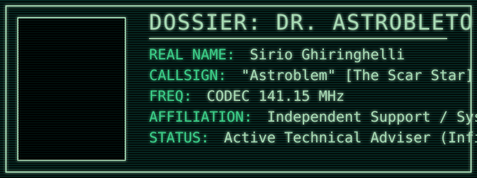

  <picture>
    <source media="(prefers-color-scheme: light)" srcset="light.svg">
    <source media="(prefers-color-scheme: dark)" srcset="dark.svg">
    
  </picture>

 

##  Chi Sono

Ciao! Sono **Sirio Ghiringhelli**, un Full-Stack Web Developer nato a Milano, ma per ora residente a Sondrio.

Dopo 10 anni di esperienza consolidata nella logistica e nel customer care, ho deciso di trasformare la mia passione per la tecnologia in una professione, applicandomi in autonomia tramite piattaforme online, come **Boot.dev**, e completando un Master intensivo in Full-Stack Web Development presso **Boolean**. 

Il mio approccio unisce la precisione organizzativa e il problem-solving del mio background precedente alla mia vivace creatività ed alla mia famelica curiosità riguardo lo sviluppo software.

Il mio obiettivo?
 
*<!-- Effetto Macchina da Scrivere Animato -->
  *

---

##  Competenze Tecniche

### Backend & Database

### Frontend & UI

### Creative & 3D (In backlog - itching to start)

### Tooling & OS

---

##  Progetti in Evidenza

* 🛒 **[Ghiri Gori Gaming](https://github.com/SirioRedGiant/E-commerce_Ghiri_Gori.git)** — *Headless E-Commerce Web App* (PHP/Laravel backend, MySQL, REST APIs, React).
* 🕹️ **[Press Start](https://github.com/SirioRedGiant/retro_games.git)** — *Full-Stack Retro-Gaming E-Commerce* (Progetto di gruppo Boolean: DB Design & CRUD).
* 👾 **[Python Arcade Lab](https://github.com/SirioRedGiant/asteroids-game)** — *2D Asteroids Engine* (Pygame) & Bookbot Text Parser.

---

##  GitHub Stats

  

##  Come Contattarmi

  
  

<!-- da migliorare il bottone-freccetta -->
 
 

  

    

      
    

     
    
      
    
  

   
  

